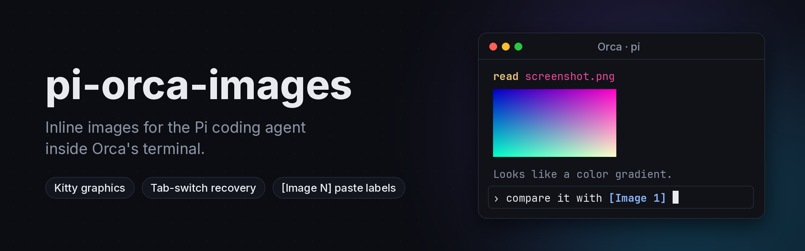
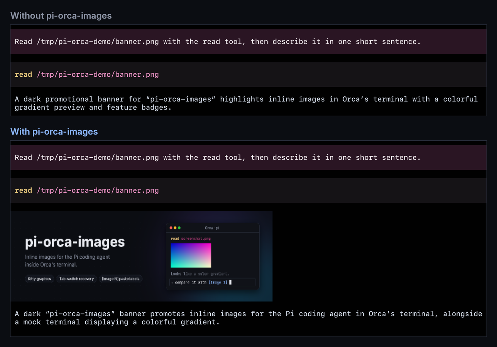
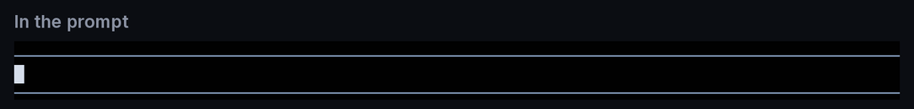

<p align="center">
  
</p>

<p align="center">
  <a href="https://www.npmjs.com/package/pi-orca-images"></a>
  <a href="https://github.com/JlMoreno00/pi-orca-images/actions/workflows/ci.yml"></a>
  <a href="https://github.com/JlMoreno00/pi-orca-images/blob/main/LICENSE"></a>
  <a href="https://pi.dev/packages"></a>
</p>

Inline images for the [Pi coding agent](https://pi.dev) inside [Orca](https://github.com/stablyai/orca)'s terminal.

Pi draws images natively (screenshots it reads, image tool results, previews), but inside Orca you get a blank gap or `Read image file [image/png]` and nothing else. This package fixes that with no configuration, and adds OpenCode-style `[Image 1]` labels for pasted images.

```bash
pi install npm:pi-orca-images
```

Restart Pi in an Orca terminal and run `/orca-images test`. You should see a color gradient.

<p align="center">
  
</p>

## What it fixes

Orca renders inline images through xterm.js's image addon. Three things keep Pi's images from showing up there:

| Problem | Cause | What this package does |
|---|---|---|
| No images at all | Pi does not recognize `TERM_PROGRAM=Orca` and ignores the `ORCA_IMAGE_PROTOCOL=kitty` hint that Orca exports | Sets `PI_IMAGE_PROTOCOL` from `ORCA_IMAGE_PROTOCOL` at startup |
| Only the first row of an image is drawn | The addon stores Kitty images per cell, so Pi's later line writes erase the rest | Turns on Pi's "draw images last" render path (the one Pi already uses for WezTerm), only while Pi renders; the variable never reaches commands Pi runs |
| Images vanish after switching tabs | When output arrives while a pane is hidden, Orca rebuilds the pane from a snapshot that has no images ([stablyai/orca#32714](https://github.com/stablyai/orca/issues/32714)) | On focus-in, re-sends every visible image a few times over the next 5 seconds, until Orca's restore has finished |

## Pasted image labels

<p align="center">
  
</p>

Paste an image (or drop an image file) into Pi's prompt and the path is shown as a bold, colored `[Image 1]` label, as in OpenCode. Labels are numbered per message, move and delete as one unit, and become the real path again when you send the message, so the model sees exactly what it saw before.

Each label is also a link to its image file: **Cmd-click** `[Image 1]` to check what you pasted before sending it. In Orca this opens an image tab with zoom controls; other terminals open it if they support OSC 8 links (iTerm2, Ghostty, WezTerm, Kitty). In any terminal on macOS, `/orca-images open 1` opens `[Image 1]` in Preview. It looks in the current prompt first, then in the last sent message that had labels, since typing the command replaces the prompt.

It recognizes pastes made only of existing image files (`png`, `jpg`, `gif`, `webp`, `bmp`, `tiff`, `heic`, `avif`): plain paths, `~/` paths, quoted or backslash-escaped paths, and `file://` URLs. Text that mixes a path with other words is left alone. This works in every terminal, not only Orca, including Pi's own clipboard paste. Set `PI_IMAGE_LABELS=0` to turn it off.

## Open image previews

Each rendered image gets an **Open image** file link beneath it. **Cmd-click** the link on macOS to open the preview through your terminal. In our Orca test, this opens an Orca image tab with zoom controls. Direct image clicks and hover-to-zoom are not supported.

On macOS, `/orca-images open` opens the last image rendered by Pi in **Preview**, using `open -a Preview`.

Preview copies are saved in a private `pi-orca-images-*` directory under the OS temporary directory, never in the project. Identical images reuse a file within each loaded extension instance. Files survive `/reload` and are deleted on normal Pi process exit; links expire when their files are removed. Crashes or forced termination can leave files behind, and long-running sessions can still accumulate previews. Older `.pi/image-previews/` folders are not automatically removed.

The saved bytes are those available to Pi and may already have been resized by a tool. Previews require automatic Orca detection and a writable temporary directory. They are inactive when `PI_ORCA_IMAGES=0` or an explicit `PI_IMAGE_PROTOCOL` overrides detection. The link and Preview command were tested with Pi 1.5.2 on macOS; opening through the command requires macOS Preview.

## Commands

| Command | Effect |
|---|---|
| `/orca-images` or `/orca-images status` | Shows the detection decision, Pi's active image protocol, and whether the repaint fix and image labels are on |
| `/orca-images test` | Draws a test gradient (it is not sent to the model) |
| `/orca-images open` | Opens the last rendered image in macOS Preview |
| `/orca-images open N` | Opens the pasted `[Image N]` in macOS Preview, from the prompt or the last sent message |
| `/orca-images redraw` | Re-sends every visible image right now |

## Configuration

The rendering fixes and preview links activate only in Orca; pasted image labels can work in any terminal. Your explicit choices always win:

| Setting | Effect |
|---|---|
| `PI_ORCA_IMAGES=0` | Disables the Orca image fixes and preview feature |
| `PI_IMAGE_LABELS=0` | Disables pasted image labels |
| `PI_IMAGE_PROTOCOL=…` | Used as is; the package does not override it |
| `terminal.images` in Pi settings | Applied by Pi on top of the package's choice |
| `terminal.showImages: false` | Pi still hides images |

## Requirements and limits

- Orca with inline images (v1.4.229 or later exports `ORCA_IMAGE_PROTOCOL`) and *Settings → Terminal → Inline Images* on (the default).
- Pi 1.4 in its default `fullscreen` TUI mode. In `regular` mode detection still works, but the repaint fix and tab recovery do not apply.
- Not inside tmux or screen: image escapes do not reach Orca through them.
- Image labels wrap internal methods of Pi's editor (`handlePaste`, `segment`, `expandPasteMarkers`, `render`). If a Pi release changes them, pasted paths simply stay as paths.
- Preview links read internal fields of Pi's image component. If those fields change or preview copies cannot be saved, links are omitted.
- The repaint fix wraps two internal methods of Pi's TUI. If a Pi release renames them, `/orca-images status` reports the fix as `unavailable` and images fall back to the first-row behavior; detection keeps working.

## Development

```bash
npm install
npm run check          # typecheck + tests
pi -e ./src/index.ts   # try it without installing
python3 scripts/banner.py  # regenerate docs/banner.png (Pillow, Inter, JetBrains Mono)
```

The screenshots in `docs/` are real captures of Pi 1.4 in Orca 1.4.229 on macOS.

## License

MIT
